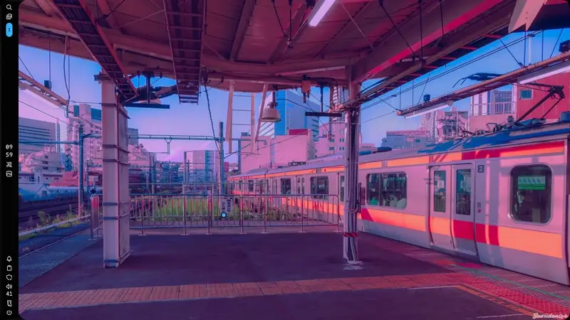

# hyprimate

hyprimate is an animation extension for [Hyprland](https://hyprland.org/) that adds custom animations to your desktop. It began as an attempt to capture the fluid motion of Apple's Liquid Glass animations, and is intended to grow with more animation styles over time.

Currently, hyprimate animates windows as they move, open, and close:

- **Liquid** gives moving windows a fluid, elastic feel and animates them in and out from the edge of the screen.
- **Wiggle** is an alternative movement style that emerged while experimenting with Liquid. It brought to mind that old-school wiggly window animation from years ago—if you know, you know.
- **Paper** is an alternative open and close style. A closing window crumples into a creased, lit ball where it is and disappears; an opening window starts as a ball at its own position and uncrumples into place.



[Watch the full-quality video](hyprimate-demo-closing.mp4)

## Installation

hyprimate currently targets **Hyprland 0.57.0**. Other versions have not been verified. You'll need `hyprpm`, matching Hyprland development headers, CMake, Ninja, and a C++26-capable compiler, along with hyprpm's dependencies. Rebuild the plugin after updating Hyprland.

Add the project's Git repository with hyprpm, then enable and load the plugin:

```sh
hyprpm add https://github.com/JustinBacher/hyprimate
hyprpm enable liquid-glass
hyprpm reload
```

The plugin is registered with hyprpm as `liquid-glass`. Access to the repository is required while it is private.

To load enabled plugins at startup, add `hyprpm reload` to your Hyprland autostart. See the [Hyprland plugin guide](https://wiki.hypr.land/Plugins/Using-Plugins/) for hyprpm dependencies, updates, and permission settings.

## Configuration

Hyprland 0.57 has a built-in **wobble** effect for moving and resizing windows, separate from hyprimate's **wiggle** style. Its `decoration.wobble.enabled` setting defaults to `false`. If you enabled it, disable it before loading hyprimate: the two window-deformation effects conflict, and the plugin will refuse to load while both are enabled. You do not need to disable Hyprland's regular window or workspace animations.

While a window opens, hyprimate drives the window's real box along the pop-out, so anything that draws at that box, such as borders and [HyprGlass](https://github.com/hyprnux/hyprglass) panes, grows out of the bead from the edge together with the window. HyprGlass needs no changes.

The example below explicitly disables Hyprland's wobble and shows all hyprimate settings with their defaults. Add the plugin settings to your Hyprland Lua configuration after the plugin has been loaded.

The movement, open, and close animations can be enabled and configured independently. To use the old-school movement effect, set `window.movement.style` to `"wiggle"`; open and close retain their own settings.

Liquid closing shrinks and travels toward the screen edge in one continuous motion, without stopping at a bead-sized hover. Close momentum advances the dive; elasticity controls its speed. The optional splash follows once the window has disappeared.

Paper (`window.open.style` or `window.close.style` set to `"paper"`) has no screen edge, bead or splash, and does not drive the window box. Its crumples are real cloth simulations of a stiff sheet squeezed from all sides into a solid ball, baked offline with Blender and shipped inside the plugin (`assets/paper_takes.bin`); `tools/paper_bake/bake_all.sh` rebakes them. The window crumples in place, facing you: it creases all over while its outline pulls in, then collapses into the ball, without spinning. Each of open and close has its own `duration`, `crumpliness`, `shading` and `variation` under `options.paper`. Closing a window that is still uncrumpling recrumples it from its current shape. Settings used by only one style live under that style's `options` table, so the liquid `strength` and `color` are set per section.

<!-- BEGIN GENERATED CONFIGURATION -->
After the first load has registered the settings, add this Lua configuration:

```lua
hl.config({
    decoration = { wobble = { enabled = false } },
    plugin = {
        ["liquid_glass"] = {
            window = {
                enabled = true,
                movement = {
                    enabled = true,
                    style = "liquid",
                    options = {
                        liquid = {
                            strength = 0.65,
                            viscosity = 0.75,
                            elasticity = 0.5,
                            momentum = 0.5,
                            variation = 0.5,
                        },
                        wiggle = {
                            strength = 0.65,
                        },
                    },
                },
                open = {
                    enabled = true,
                    style = "liquid",
                    options = {
                        liquid = {
                            strength = 0.65,
                            color = 0xff000000,
                            first_window_side = "bottom",
                            edge_bounds = "screen",
                            emerge_drag = 0.5,
                            elasticity = 0.5,
                            momentum = 0.5,
                        },
                        paper = {
                            duration = 0.6,
                            crumpliness = 0.6,
                            shading = 0.7,
                            variation = 0.5,
                        },
                    },
                },
                close = {
                    enabled = true,
                    style = "liquid",
                    options = {
                        liquid = {
                            strength = 0.65,
                            color = 0xff000000,
                            side = "auto",
                            edge_bounds = "screen",
                            splash = true,
                            elasticity = 0.5,
                            momentum = 0.5,
                        },
                        paper = {
                            duration = 0.5,
                            crumpliness = 0.6,
                            shading = 0.7,
                            variation = 0.5,
                        },
                    },
                },
            },
        },
    },
})
```

Hyprland 0.57 normalizes hyphens to underscores in Lua config names: use `liquid_glass` in `hl.config`, while the plugin name and `hyprctl` keys remain `liquid-glass` / `plugin:liquid-glass:*`. Each nested Lua table maps to colon-separated segments of the key, for example `window.movement.options.liquid.viscosity` is `plugin:liquid-glass:window:movement:options:liquid:viscosity`.

| Setting | Type / default | Meaning |
|---|---|---|
| `plugin:liquid-glass:window:enabled` | boolean / `true` | Master switch: when false, no movement, open or close deformation runs. |
| `plugin:liquid-glass:window:movement:enabled` | boolean / `true` | Deform windows while they move. Does not enable or disable open or close. |
| `plugin:liquid-glass:window:movement:style` | string / `"liquid"` | Movement material; invalid names are rejected. Allowed: `liquid`, `wiggle`. |
| `plugin:liquid-glass:window:movement:options:liquid:strength` | float / `0.65` | Liquid-only movement deformation intensity; zero moves windows undeformed. Finite values clamped to 0–1.5. |
| `plugin:liquid-glass:window:movement:options:liquid:viscosity` | float / `0.75` | Liquid-only internal flow resistance; higher is thicker and more cohesive. Finite values clamped to 0–1. |
| `plugin:liquid-glass:window:movement:options:liquid:elasticity` | float / `0.5` | Liquid-only movement stiffness and recovery speed; higher snaps back faster. Finite values clamped to 0–1. |
| `plugin:liquid-glass:window:movement:options:liquid:momentum` | float / `0.5` | Liquid-only movement inertia after a stop; zero lands without overshoot. Finite values clamped to 0–1. |
| `plugin:liquid-glass:window:movement:options:liquid:variation` | float / `0.5` | Liquid-only per-window and per-movement randomness; zero moves windows identically. Finite values clamped to 0–1. |
| `plugin:liquid-glass:window:movement:options:wiggle:strength` | float / `0.65` | Wiggle-only movement deformation intensity; zero moves windows undeformed. Finite values clamped to 0–1.5. |
| `plugin:liquid-glass:window:open:enabled` | boolean / `true` | Animate windows as they open (see style); false opens without it. Movement is unaffected. |
| `plugin:liquid-glass:window:open:style` | string / `"liquid"` | Open material; invalid names are rejected. Allowed: `liquid`, `paper`. |
| `plugin:liquid-glass:window:open:options:liquid:strength` | float / `0.65` | Liquid-only pop-out size and deformation intensity; zero opens without the pop-out. Finite values clamped to 0–1.5. |
| `plugin:liquid-glass:window:open:options:liquid:color` | color / `0xff000000` | Liquid-only edge liquid colour (ARGB); alpha zero draws no liquid. |
| `plugin:liquid-glass:window:open:options:liquid:first_window_side` | string / `"bottom"` | Edge the first window on a workspace pops out of; later windows use the side they appear on (see Edge choice). Allowed: `bottom`, `top`, `left`, `right`. |
| `plugin:liquid-glass:window:open:options:liquid:edge_bounds` | string / `"screen"` | Use monitor edges (screen) or edges inside reserved areas (work_area) for the pop-out. Allowed: `screen`, `work_area`. |
| `plugin:liquid-glass:window:open:options:liquid:emerge_drag` | float / `0.5` | Share of pop-out travel fed to the movement field as drag; zero is a rigid pop. Finite values clamped to 0–1. |
| `plugin:liquid-glass:window:open:options:liquid:elasticity` | float / `0.5` | Open-only stiffness and recovery speed of the pop-out; higher snaps back faster. Finite values clamped to 0–1. |
| `plugin:liquid-glass:window:open:options:liquid:momentum` | float / `0.5` | Open-only inertia of the pop-out; zero lands without overshoot. Finite values clamped to 0–1. |
| `plugin:liquid-glass:window:open:options:paper:duration` | float / `0.6` | Paper-only seconds for the ball to uncrumple into the window. Finite values clamped to 0.1–3. |
| `plugin:liquid-glass:window:open:options:paper:crumpliness` | float / `0.6` | Paper-only crumple tightness; higher crumples into a smaller, more creased ball. Finite values clamped to 0–1. |
| `plugin:liquid-glass:window:open:options:paper:shading` | float / `0.7` | Paper-only light and shadow on the creases; zero draws the folds unlit. Finite values clamped to 0–1. |
| `plugin:liquid-glass:window:open:options:paper:variation` | float / `0.5` | Paper-only per-window randomness of which crumple plays and its mirroring; zero crumples every window identically. Finite values clamped to 0–1. |
| `plugin:liquid-glass:window:close:enabled` | boolean / `true` | Animate windows as they close (see style); false closes natively. Movement is unaffected. |
| `plugin:liquid-glass:window:close:style` | string / `"liquid"` | Close material; invalid names are rejected. Allowed: `liquid`, `paper`. |
| `plugin:liquid-glass:window:close:options:liquid:strength` | float / `0.65` | Liquid-only drain deformation intensity; zero closes natively. Finite values clamped to 0–1.5. |
| `plugin:liquid-glass:window:close:options:liquid:color` | color / `0xff000000` | Liquid-only edge liquid colour (ARGB); alpha zero draws no liquid. |
| `plugin:liquid-glass:window:close:options:liquid:side` | string / `"auto"` | Drain by side of appearance (auto), nearest valid edge, or opening edge (origin, falling back to auto). Allowed: `auto`, `nearest`, `origin`. |
| `plugin:liquid-glass:window:close:options:liquid:edge_bounds` | string / `"screen"` | Use monitor edges (screen) or edges inside reserved areas (work_area) for the drain. Allowed: `screen`, `work_area`. |
| `plugin:liquid-glass:window:close:options:liquid:splash` | boolean / `true` | Small edge-liquid splash where a closing window disappears; false closes without liquid. |
| `plugin:liquid-glass:window:close:options:liquid:elasticity` | float / `0.5` | Close-only stiffness and recovery speed of the drain; higher snaps back faster. Finite values clamped to 0–1. |
| `plugin:liquid-glass:window:close:options:liquid:momentum` | float / `0.5` | Close-only dive acceleration; higher advances the dive faster. Finite values clamped to 0–1. |
| `plugin:liquid-glass:window:close:options:paper:duration` | float / `0.5` | Paper-only seconds to crumple the window into a ball and vanish. Finite values clamped to 0.1–3. |
| `plugin:liquid-glass:window:close:options:paper:crumpliness` | float / `0.6` | Paper-only crumple tightness; higher crumples into a smaller, more creased ball. Finite values clamped to 0–1. |
| `plugin:liquid-glass:window:close:options:paper:shading` | float / `0.7` | Paper-only light and shadow on the creases; zero draws the folds unlit. Finite values clamped to 0–1. |
| `plugin:liquid-glass:window:close:options:paper:variation` | float / `0.5` | Paper-only per-window randomness of which crumple plays and its mirroring; zero crumples every window identically. Finite values clamped to 0–1. |
<!-- END GENERATED CONFIGURATION -->

### Edge choice

The first window on a workspace opens from `first_window_side`. Later tiled windows normally open from the screen edge on the side where they appear; floating windows and windows without a clear neighboring window use the nearest valid edge. Set `edge_bounds` to `"work_area"` to use edges inside reserved areas instead of the screen edges.

For closing windows, `side = "auto"` chooses the side of appearance, `"nearest"` uses the nearest valid edge, and `"origin"` uses the opening edge when available.

## Development

Format the C++ sources with `clang-format`:

```sh
cmake -S . -B build
cmake --build build --target format
```

Check formatting without changing files with `cmake --build build --target format-check`.
